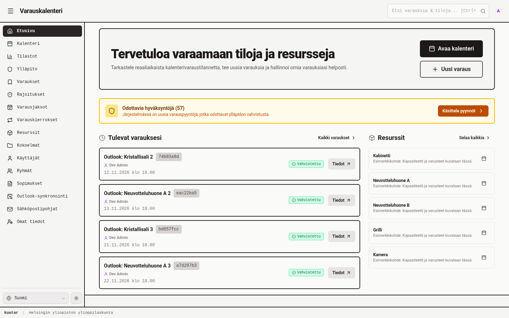
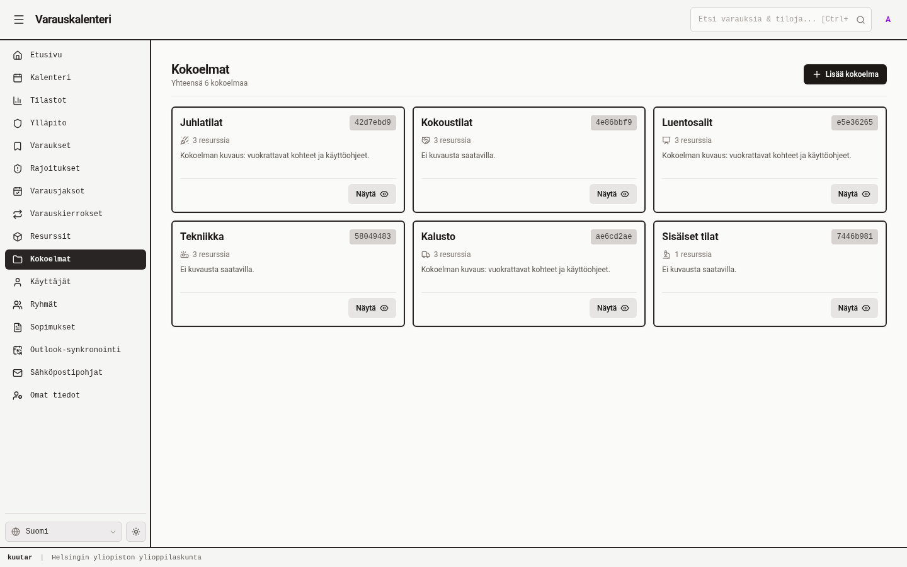
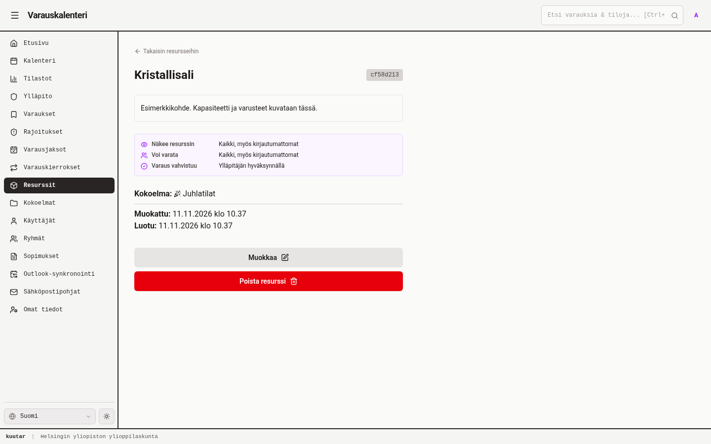
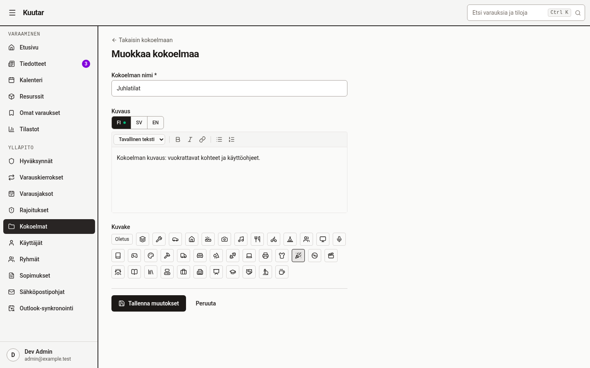

# Kuutar UI style guide

How Kuutar's client looks and how pages are put together. Read this before UI work and keep it in
step with the code: when you add a reusable pattern, add it here. The source of truth is the code
(`client/src/styles.css` and the components in `client/src/components/`); this file explains how to
use them. Reference screenshots live in [`screenshots/pages/`](screenshots/pages/) and are
regenerated with `pnpm screenshots` (see `CLAUDE.md`).

## Character

Quiet, dense and functional. Warm stone greys, black primary buttons, thin borders and no drop
shadows. Colour is reserved for state (status chips, callouts) and for the purple accent on links and
focus. The app is used by students and staff to get a booking done, so pages lead with the task and
avoid decoration.



## Colour tokens

Defined in `client/src/styles.css` as CSS variables, redefined under `.dark`, and exposed to
Tailwind through `@theme inline`. Prefer the token classes in new code; they switch with the theme on
their own.

| Token class | Use |
|---|---|
| `bg-surface` | Page background |
| `bg-surface-raised` | Cards, list rows, panels |
| `bg-surface-muted` | Recessed areas (toolbars, inline panels) |
| `bg-surface-hover` | Hover tint (used by `hover-card`) |
| `border-line-subtle` | Default 1px borders on cards, sections and inputs |
| `border-line-strong` | Emphasised borders, hover outline, the shell divider |
| `text-ink` / `text-ink-muted` | Body text / secondary text (meta lines, subtitles, counts) |
| `text-accent`, `outline-accent-focus` | Links, the accent dot, the focus ring (purple) |
| `*-status-{neutral,success,warning,danger,info}-{bg,line,ink}` | State colours; use them only through `StatusChip` and `Callout` |

Much existing code still spells out `text-stone-900 dark:text-stone-100` and
`text-stone-600 dark:text-stone-400`. These match `text-ink` and `text-ink-muted`. Both forms are
fine; don't mix them within one element.

Other rules:
- The stone palette is overridden in dark mode (`--color-stone-700…950`) to be warmer. Don't hardcode hex values.
- Rich-text links are amber (`richTextClassName` in `client/src/utils/richText.ts`); UI links are the accent purple.
- Status is never shown by colour alone: always pair it with text and, where the state has one, an icon.

## Typography

| Element | Classes |
|---|---|
| Page title (h1, in `PageHeader`) | `text-2xl font-bold tracking-tight` |
| Section title (h2) | `text-lg font-semibold` |
| Card title | `text-base font-bold` (`EntityCard`) or `text-sm font-bold` in compact list rows |
| Body | `text-sm` |
| Meta, captions, hints | `text-xs text-ink-muted`; times and counts get `tabular-nums` |
| Sidebar group label | `text-xs font-mono uppercase tracking-wider text-ink-muted` |
| Hero (guest home only) | `text-4xl font-extrabold tracking-tight` |

## Shape, spacing, interaction

- **Radius:** `rounded-md` for controls, cards and sections; `rounded-sm` for chips.
- **Borders:** 1px `border-line-subtle`. Use a dashed border only for empty states (`EmptyState`) and the danger zone.
- **Shadows:** none. Hover on a clickable card or row is `hover-card`, which draws a thicker inset border plus a surface tint, so nothing shifts.
- **Focus:** add `focus-ring` to every interactive element that isn't a `Button` (which already has it).
- **Rhythm:** `PageContainer` stacks children with vertical spacing. Inside a section use `space-y-3`; between grid columns use `gap-6`.
- **Icons:** `lucide-react`, 16px in nav and rows, 18px in buttons, 12–14px in chips and back links. Decorative icons get `aria-hidden`.
- **Loading:** a `Loader2` with `animate-spin` (18px) and a muted text line, centred in the section (`p-8`).

## Page anatomy

Every page is a `PageContainer` with a `PageHeader` at the top.

| Width | Use |
|---|---|
| `wide` (`max-w-7xl`) | Lists, grids, tables, dashboards |
| `default` (`max-w-3xl`) | Detail pages |
| `narrow` (`max-w-xl`) | Single-column forms |
| `FormLayout` (`max-w-5xl`) | Create/edit pages |

`PageHeader` slots:
- `title`: the nav label on list pages, the entity name on detail pages. No icon.
- `subtitle`: one muted line, e.g. a count ("Yhteensä 6 kokoelmaa").
- `actions`: at most one primary button, then secondary (`outline`) ones.
- `back`: a `BackLink` ("Takaisin …"), shown above the title.
- `status`: a `StatusChip` next to the title on detail pages.

There is no divider under the header.

### List pages

A `PageHeader` with a count subtitle and a primary "Lisää …" action, then a grid of `EntityCard`s
(`grid grid-cols-1 gap-4 sm:grid-cols-2 xl:grid-cols-3`) or a stacked list. When there is nothing to show, use `EmptyState`.



`EntityCard` rules:
- The whole card is the link. Never put edit or delete buttons, or ids, on a card.
- Optional leading icon.
- One meta line.
- The description is clamped to two lines. Omit it when empty; never print a placeholder.
- At most 3 badges, and only for non-default states.

Compact list rows (home page sections) use
`focus-ring block rounded-md hover-card border border-line-subtle bg-surface-raised p-3`: a bold
`text-sm` title, then a `text-xs` muted line, with a `StatusChip` on the right when there is one.

### Section header with "see all"

```tsx
<div className="flex items-center justify-between gap-2">
  <h2 className="text-lg font-semibold">…</h2>
  <Button variant="ghost" size="sm" asChild>
    <Link to="…"><span>Selaa kaikkia</span><ChevronRight size={14} /></Link>
  </Button>
</div>
```

### Detail pages

Use `DetailLayout`. The header holds the back link, the title, a status chip and actions (the
primary action, then "Muokkaa" as `outline`). The body is made of L2 sections (bordered
`rounded-md` boxes or `Callout`s). Destructive actions go only in `dangerZone`, as `danger-outline`
buttons inside the dashed red "Vaaralliset toiminnot" section. The collapsed "Tekniset tiedot" footer
shows the id and timestamps.



### Forms

Short forms use `FormLayout` with a `PageHeader` (back link + "Muokkaa …" or "Uusi …"), the fields,
then `FormActions`. Long forms use `GuidedFormLayout`: numbered `FormSection`s with a sticky index
and summary on wide screens, and `StickyFormActions`.



- **Labels:** `text-sm font-medium` above the field. Mark required fields with `*` (`aria-hidden`) and give the input `aria-required`.
- **Errors:** `text-xs text-red-600 dark:text-red-400` under the field; pass `isError` to `Input`.
- **Localized fields:** `LocalizedRichTextEditor` puts FI/SV/EN `LocaleTabs` above the editor. A dot marks the languages that have content.
- **Actions:** `FormActions` puts the primary button first ("Tallenna muutokset" / "Luo …", with an icon) and a ghost "Peruuta" after it. Never put the primary button on the right.

## Components to reach for

| Need | Component |
|---|---|
| Buttons | `Button`: `default` (black, primary), `outline` (secondary), `secondary`, `ghost` (toolbar, "see all", cancel), `danger-outline` (unconfirmed destructive), `danger` (only the confirm button inside a confirmation dialog). Sizes `sm`/`md`/`lg`/`icon`/`iconSm`. Use `asChild` to render a `Link` |
| State label | `StatusChip`: warning = pending, success = confirmed/open, danger = cancelled/rejected, neutral = past/inactive, info = informational |
| Neutral tag | `Chip` (names, categories). Toggleable: `ToggleChip`; multi-select: `ChipSelect` |
| Notice | `Callout` (`info`/`warning`/`danger`/`success`, optional title and action). It replaces every ad-hoc coloured box |
| Nothing to show | `EmptyState` (icon, title, optional text and action) |
| Choose one of a few | `SegmentedControl` |
| Pick groups | `GroupChecklist` |
| Date / time | `DateInput`, `DateTimeInput` |
| Rich text | `LocalizedRichTextEditor` to edit, `RichTextContent` to render (with locale fallback) |
| Tooltip | `Tooltip` (the collapsed sidebar uses it for labels) |

Before writing a new component, check `client/src/components/` and the Storybook stories. A new
reusable component gets a `*.stories.tsx` and, if it has logic, a `*.test.tsx`.

## Shell and navigation

The sidebar (`SideBar.tsx`) has two groups, "Varaaminen" and "Ylläpito", each with a mono uppercase
label. Items are `text-sm font-medium` with a 16px icon. The active item is inverted
(`bg-stone-800 text-stone-100`, light in dark mode). When collapsed, the sidebar becomes an icon rail
with tooltips. Each nav item has an access level (`public` / `auth` / `admin`). A 2px dark border
(`border-stone-800 dark:border-stone-600`) separates the header and sidebar from the content.

## Dark mode and locales

- Every page must work in light and dark. Check the `*.fi.dark.png` screenshot variants.
- Every page must hold up in fi, sv and en. Finnish and Swedish strings run longer, so let titles and buttons wrap (`flex-wrap`, `wrap-break-word`) instead of truncating actions.
- Write strings as `t("camelCaseKey", "Finnish default")`. Put the text in all three of `client/messages/{fi,sv,en}.json`.

## Accessibility

- Use semantic headings (one h1 per page, from `PageHeader`) and landmarks (`nav` with `aria-label`).
- Icon-only buttons need `aria-label`.
- Live feedback goes in `<output>` or `role="status"`. `Callout` uses `role="alert"` for danger and `role="note"` otherwise.
- Never convey meaning by colour alone. Text contrast follows the token pairs above.
